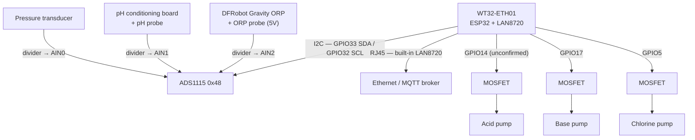

# Hardware

## Implemented today

| Component | Part | Notes |
|-----------|------|-------|
| MCU + Ethernet | WT32-ETH01 (ESP32 + LAN8720) | Wired ethernet, no extra SPI module needed |
| ADC | ADS1115 (16-bit, I2C, address 0x48) | AIN0 = pH, AIN1 = pressure, AIN2 = ORP — single-ended, ±4.096V full-scale |
| pH circuit | Analog pH probe conditioning board + probe | Output through a per-channel voltage divider into AIN0 |
| ORP circuit | DFRobot Gravity Analog ORP Sensor (SEN0165) + probe | 5V-powered conditioning board, output through a per-channel voltage divider into AIN2 |
| Pressure | Analog pressure transducer | Output through a per-channel voltage divider into AIN1 — not yet converted to physical units (bar), publishes divider-corrected volts |
| Dosing pumps | 3× peristaltic pump (acid, base, chlorine) | Each switched by a MOSFET from a dedicated GPIO — see [mqtt.md](mqtt.md) for the `pool/cmd/dose/*` commands and [calibration.md](calibration.md)-style safety notes in `dosing.rs` |

Each ADS1115 channel sits behind its **own** voltage divider sized to keep the input safely under the ADC's 3.3V rail (no level shifter — the ADS1115 itself runs on 3.3V alongside the ESP32's I2C bus). The three ratios are independently adjustable at runtime over MQTT (see [mqtt.md](mqtt.md)) rather than fixed in firmware, since the resistor values are still being tuned per channel.

Dosing pump control is currently a **baseline safety net only**: fail-safe-off default, mutual exclusion (one pump at a time, extra commands rejected outright rather than queued), and a hard per-dose duration clamp. Sensor-gated dosing, fractional/re-measure dosing, daily limits, and fault-code state from the original design are **not implemented** — see [roadmap.md](roadmap.md).

> **Pin-selection history**: base and chlorine were originally wired to GPIO1/GPIO3 (UART0 TXD/RXD). Those pins didn't actually toggle under firmware control — GPIO1/GPIO3 default to the UART0 peripheral's IO_MUX function at reset, and `gpio_set_direction()` (what `PinDriver::output()` calls) only sets input/output-enable bits, it doesn't force the pin's IO_MUX function to plain GPIO. Moved to GPIO17/GPIO5, which don't have that alternate default function, and both work correctly. Acid (GPIO14, RTC/JTAG-capable) showed the same "doesn't move" symptom even probed directly on the bare chip with an oscilloscope, still under investigation — see [roadmap.md](roadmap.md) if this resurfaces. **The pump outputs are active-high** (GPIO high = pump on, low = off) — a brief detour through active-low logic during debugging turned out to be wrong and was reverted; `dosing.rs` now drives `set_high()`/`set_low()` directly with no inversion layer.

## Not yet implemented

These appear in the original hardware plan but have no corresponding firmware code yet — see [roadmap.md](roadmap.md):

- Temperature probes (DS18B20, 1-Wire)
- Full dosing safety logic (sensor validation, fractional dosing, daily limits, fault codes) — basic on/off dosing with mutual exclusion is implemented, the rest isn't

## GPIO usage (WT32-ETH01)

The WT32-ETH01's internal EMAC + LAN8720 PHY claims a fixed, board-wired set of pins — this is silicon/board wiring, not a firmware choice, and these pins are **unavailable for anything else**:

| GPIO | RMII signal |
|------|-------------|
| 25 | RXD0 |
| 26 | RXD1 |
| 27 | CRS_DV |
| 23 | MDC |
| 22 | TXD1 |
| 21 | TX_EN |
| 19 | TXD0 |
| 18 | MDIO |
| 0  | REF_CLK (input) |
| 16 | PHY reset |

On top of that, the current firmware uses:

| GPIO | Function |
|------|----------|
| 33 | I2C SDA (ADS1115) |
| 32 | I2C SCL (ADS1115) |
| 14 | Acid pump MOSFET gate — not confirmed working yet, see the pin-selection note above |
| 17 | Base pump MOSFET gate |
| 5  | Chlorine pump MOSFET gate |

That's 15 GPIOs already committed. **Note for future features**: an earlier hardware sketch assumed GPIO32/33 were free for temperature (1-Wire) — that's no longer true now that I2C lives there. GPIO1 and GPIO3 (UART0 TXD/RXD) and GPIO14 are known **not** to work as plain digital outputs on this board so far — avoid them for new peripherals until/unless that's root-caused. Check the WT32-ETH01 pinout for what's actually broken out on your board's header before wiring anything new.

## Wiring (current)

> **Reminder:** GPIO0/16/18/19/21/22/23/25/26/27 are reserved by ethernet; GPIO32/33 by I2C; GPIO1/3/14 have not worked reliably as dosing outputs so far. See the tables above before adding anything new.
